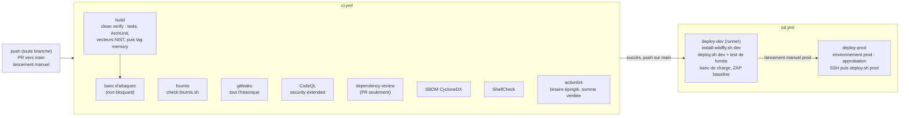

# Chaîne CI/CD SecDevOps

Deux workflows GitHub Actions, des scripts bash d'infrastructure (Infrastructure as Code) et deux bancs Java.



## Correspondance exigences → jobs

| Exigence | Où | Bloquant |
|---|---|---|
| Compilation, tests unitaires, règles d'architecture (ArchUnit, 3 modules) | `ci.yml` › `build` (`mvn clean verify`) | oui |
| Vecteurs officiels AES-256-GCM à chaque commit (dossier v2.6 §8.7) | `AesGcmNistVectorsTest` (CAVP `gcmEncryptExtIV256.rsp`, Count 0 et 1), dans `build` | oui |
| Budget mémoire de l'embedding | `build`, étape `-Dgroups=memory -DargLine=-Xmx300m` | oui |
| Aucun secret dans le dépôt | `gitleaks` (historique complet, `.gitleaks.toml` : une seule exception, le PDF du dossier) | oui |
| Analyse statique de sécurité | `codeql` (Java, `security-extended`, résultats dans l'onglet Security) | alertes dans Security |
| Dépendances vulnérables | `dependency-review` (PR, échec dès la gravité `high`) ; Dependabot chaque semaine | oui (PR) |
| Nomenclature logicielle | `sbom` (CycloneDX 2.9.3, agrégée, artefact `sbom-cyclonedx`) | oui |
| Scripts shell propres | `shellcheck` (tous les `scripts/**/*.sh`) | oui |
| Workflows GitHub Actions valides | `actionlint` (binaire officiel `rhysd/actionlint` 1.7.12, somme SHA-256 épinglée dans `ci.yml` ; analyse aussi les blocs `run:` avec ShellCheck) | oui |
| Scripts de base fournis intacts | `fournis` (`scripts/check-fournis.sh`, sommes SHA-256 de `scripts/wildfly/fournis/`) | oui |
| Banc de robustesse (SEC-D04) : JPEG Q75 en 8 et 12 bits, redimensionnement 75 %, PSNR, faux positifs | `attack-bench` (`AttackBench`, artefact `banc-attaques`, rapport dans le résumé) | non (`continue-on-error`) ; le programme échoue si PSNR < 40 dB ou faux positifs > 1 % |
| Déploiement reproductible de WildFly 42 (hôtes virtuels, TLS 1.3, limites) | `cd.yml` › `deploy-dev` : `install-wildfly.sh dev` | oui |
| Test de fumée (santé, en-têtes, HTTPS, TLS 1.2 refusé, 401 problem+json) | `deploy-dev` : `deploy.sh dev` | oui ; `/api/whoami` en 404 n'est qu'un avertissement jusqu'au prompt 12 |
| Objectif SRE : p95 < 2 s (SEC-R02), aucune requête suspendue > 10 s | `deploy-dev` : `LoadBench` (500 + 200 requêtes à 20 en parallèle, rafale de 200), tas du serveur avant et après | oui |
| Scan dynamique | `deploy-dev` : ZAP baseline sur api et www (`.zap/rules.tsv`) | règles `FAIL` seulement |
| Journaux en cas d'échec | `deploy-dev` : artefact `journaux-wildfly` | — |
| Mise en production contrôlée | `deploy-prod` : environnement `prod` avec relecteurs obligatoires, SSH à hôte vérifié | oui |
| Mise à jour de WildFly sans perte de configuration | `scripts/update-wildfly.sh` (manuel ou tâche planifiée sur le serveur) | — |

Commandes locales équivalentes :

```
mvn -B -f middleware/pom.xml clean verify
mvn -B -f middleware/pom.xml -pl core -am install -DskipTests
mvn -B -f middleware/pom.xml -pl api test-compile exec:java@attack-bench   # rapport : middleware/api/target/bench/
mvn -B -f middleware/pom.xml -pl api test-compile exec:java@load-bench     # contre un WildFly déployé
```

`exec:java@<id>` désigne une exécution nommée du pom d'api : la configuration du plugin y fixe déjà `mainClass`
(simulateur de collusions), que `-Dexec.mainClass` ne remplacerait pas.

## Banc d'attaques

Le banc réutilise les fantômes des tests d'embedding (`tn.medimagetrust.embedding.Phantoms`, rendu public pour cela)
et la vraie chaîne `EmbeddingSession` + `FingerprintService`, avec une clé K_F de test fixe. Il mesure, par fantôme
(8 et 12 bits) et par scénario : les bits F relus, l'attribution (vrai destinataire accusé), les faux positifs (un
innocent accusé sur une copie, ou une accusation sur l'image non marquée), le PSNR.

Résultat local (20 copies par fantôme, 64 destinataires) : voir le rapport `report.md` produit par le job ; résumé
dans `middleware/README.md` (écarts connus).

**Échec en 12 bits : cause.** Le pas QIM est fixe, Δ = 12 valeurs stockées (`EmbeddingProfile.QIM_DELTA`), quelle que
soit la profondeur. En 12 bits (4096 niveaux), ce pas est trop petit : le passage en 8 bits imposé par JPEG le ramène à
moins d'un niveau de gris, et l'interpolation du redimensionnement déplace les coefficients de bien plus que Δ/4 ; F
est effacé (≈ 50 % des bits, le hasard), sans fausse accusation. **Correction prévue au prompt 09 : Δ proportionnel à
la profondeur.** D'ici là, une récupération sous 95 % reste un avertissement (`::warning::`), et le job ne bloque pas.

**Critère de mesure.** La récupération est mesurée de deux façons (taux de bits F relus, attribution du vrai
destinataire) et sur deux profondeurs (8 et 12 bits). Critère bloquant : PSNR ≥ 40 dB et faux positifs ≤ 1 %. Une
récupération des bits sous 95 % produit un avertissement ; elle est suivie comme une dette technique (pas QIM
proportionnel à la profondeur, prévu).

## ZAP baseline : règles ignorées

| Règle | Action | Raison |
|---|---|---|
| 10049 Storable/Non-Storable Content | IGNORE | informative ; l'API répond `Cache-Control: no-store` volontairement (SEC08) |
| 10109 Modern Web Application | IGNORE | informative, signale seulement une application JavaScript |

Règles bloquantes (`FAIL`) : 10035 (HSTS), 10021 (`X-Content-Type-Options`, posé sur les quatre hôtes par
durcissement de `add-api.cli`), 10036 (`Server`) et 10037 (`X-Powered-By`) (voir `scripts/wildfly/MODIFICATIONS.md`),
10010, 10011, 10054 (attributs des cookies), 10023 et 90022 (divulgation d'erreurs). Les autres restent des
avertissements (`cmd_options: -I`).

## Protection de `main` (à faire dans GitHub, une fois)

Settings › Branches › Add branch ruleset (ou « branch protection rule ») sur `main` :

1. Require a pull request before merging, avec au moins une approbation et « Require review from Code Owners »
   (`.github/CODEOWNERS`).
2. Require status checks to pass : `build (compilation, tests, ArchUnit)`, `scripts de base fournis intacts`,
   `gitleaks (secrets dans tout l'historique)`, `CodeQL (Java)`, `revue des dépendances (PR)`, `SBOM CycloneDX`,
   `ShellCheck`, `actionlint` ; cocher « Require branches to be up to date ». Le banc d'attaques n'en fait pas partie.
3. Block force pushes ; Restrict deletions ; Require linear history (facultatif).
4. Settings › Code security : activer Dependabot alerts et Dependabot security updates (cette dernière est
   **désactivée** au 27/11/2026 d'après l'API GitHub) ; Secret scanning et Push protection sont déjà actifs.

### `dependency-review` et visibilité du dépôt

`dependency-review-action` s'appuie sur le dependency graph de GitHub. Il est disponible sans licence sur un dépôt
**public**, mais exige GitHub Advanced Security (GHAS) sur un dépôt privé. Vérification faite le 27/11/2026 :
`gh repo view --json visibility` renvoie `PUBLIC` pour `Amal-wa/MedImage-Trust`. Le job n'est donc **pas** conditionné
par la visibilité. Si le dépôt devient privé sans GHAS, ajouter au job `if: github.event_name == 'pull_request' &&
github.event.repository.private == false` (le job serait sinon toujours en échec), et le retirer des checks
obligatoires.

### actionlint

Le job `actionlint` télécharge le binaire officiel `actionlint_1.7.12_linux_amd64.tar.gz` depuis les releases de
`rhysd/actionlint` et vérifie sa somme SHA-256, écrite en dur dans `ci.yml`
(`8aca8db96f1b94770f1b0d72b6dddcb1ebb8123cb3712530b08cc387b349a3d8`). Cette somme a été relevée le 27/11/2026, et deux
sources concordaient : le fichier `actionlint_1.7.12_checksums.txt` de la release et l'empreinte de l'asset donnée par
l'API GitHub. Dependabot ne suit pas ce binaire : pour changer de version, mettre à jour `ACTIONLINT_VERSION` et
`ACTIONLINT_SHA256` ensemble.

## Environnements et secrets

Settings › Environments :

- `dev` : aucun secret ; le runner génère son certificat autosigné et son mot de passe de magasin à chaque passage.
- `prod` : **Required reviewers** (au moins une personne de l'équipe), « Deployment branches : main » ; puis :

| Nom | Type | Contenu |
|---|---|---|
| `PROD_HOST` | secret | nom ou adresse du serveur |
| `PROD_USER` | secret | utilisateur de déploiement (non root, propriétaire de `/opt/medimage`) |
| `PROD_SSH_KEY` | secret | clé privée ed25519 dédiée au déploiement, sans phrase de passe, autorisée seulement pour cet utilisateur |
| `PROD_KNOWN_HOSTS` | secret | sortie de `ssh-keyscan -t ed25519 <serveur>`, vérifiée hors bande (empreinte) |
| `MIT_DOMAIN` | variable | domaine deSEC, par exemple `medimage.dedyn.io` (pas un secret) |

Tant qu'une de ces valeurs manque, `deploy-prod` s'arrête proprement avec l'annonce « prod non configurée », sans
échec. Le jeton deSEC (`DESEC_TOKEN`) ne sert qu'au défi DNS-01 de certbot **sur le serveur** : il n'est ni dans le
dépôt ni dans GitHub (voir `scripts/README.md`, « Ce qui reste manuel en prod »).
