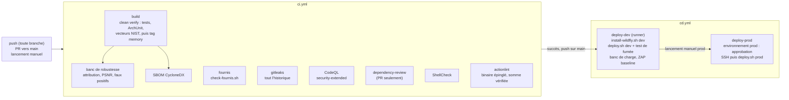

# Chaîne CI/CD SecDevOps

Deux workflows GitHub Actions, des scripts bash d'infrastructure (Infrastructure as Code) et deux bancs Java.



## Correspondance exigences → jobs

| Exigence | Où | Bloquant |
|---|---|---|
| Compilation, tests unitaires, règles d'architecture (ArchUnit, 3 modules) | `ci.yml` › `build` (`mvn clean verify`) | oui |
| Vecteurs officiels AES-256-GCM à chaque commit (dossier v2.6 §8.7) | `AesGcmNistVectorsTest` (CAVP `gcmEncryptExtIV256.rsp`, Count 0 et 1), dans `build` | oui |
| Budget mémoire de l'embedding | `build`, étape `-Dgroups=memory -DargLine=-Xmx300m` | oui |
| Aucun secret dans le dépôt | `gitleaks` (historique complet, `.gitleaks.toml` : une seule exception, le PDF du dossier) | oui |
| Analyse statique de sécurité | `codeql` (Java, `security-extended`, résultats dans l'onglet Security) | alertes dans Security |
| Dépendances vulnérables | `dependency-review` (PR, échec dès la gravité `high`) ; Dependabot chaque semaine | oui (PR) |
| Nomenclature logicielle | `sbom` (CycloneDX 2.9.3, épinglé dans le `pluginManagement` de `middleware/pom.xml`, agrégée, artefact `sbom-cyclonedx`) | oui |
| Intégrité des dépendances Maven | `middleware/.mvn/maven.config` : `--strict-checksums`, un artefact dont le condensat ne correspond pas fait échouer le build (tous les jobs Maven) | oui |
| Scripts shell propres | `shellcheck` (tous les `scripts/**/*.sh`) | oui |
| Workflows GitHub Actions valides | `actionlint` (binaire officiel `rhysd/actionlint` 1.7.12, somme SHA-256 épinglée dans `ci.yml` ; analyse aussi les blocs `run:` avec ShellCheck) | oui |
| Scripts de base fournis intacts | `fournis` (`scripts/check-fournis.sh`, sommes SHA-256 de `scripts/wildfly/fournis/`) | oui |
| Banc de robustesse (SEC-D04) : JPEG Q75 en 8 et 12 bits, redimensionnement 75 %, attribution, PSNR, faux positifs | `attack-bench` (`AttackBench`, artefact `banc-attaques`, rapport dans le résumé) | oui : vrai destinataire accusé dans toutes les copies de chaque scénario, faux positifs ≤ 1 %, PSNR ≥ 40 dB ; bits F < 95 % : avertissement seulement |
| Corpus réel (docs/CORPUS.md) : lecture sûre, marquage, copie relue, aucun `.dcm` dans le dépôt | `corpus` : `scripts/corpus/fetch-corpus.sh` (API publique TCIA, SHA-256 vérifiées, cache `actions/cache` indexé par la SHA-256 de `docs/CORPUS.md`), puis tests `-Dgroups=corpus` ; banc « Corpus réel » en fin de job, artefact `corpus-reel` | oui pour le téléchargement et les tests ; section « Corpus réel » du banc : non bloquante (`continue-on-error`) |
| Déploiement reproductible de WildFly 42 (hôtes virtuels, TLS 1.3, limites) | `cd.yml` › `deploy-dev` : `install-wildfly.sh dev` | oui |
| Test de fumée (santé, en-têtes, HTTPS, TLS 1.2 refusé, 401 problem+json) | `deploy-dev` : `deploy.sh dev` | oui ; `/api/whoami` en 404 n'est qu'un avertissement jusqu'au prompt 12 |
| Objectif SRE : p95 < 2 s (SEC-R02), aucune requête suspendue > 10 s | `deploy-dev` : `LoadBench` (500 + 200 requêtes à 20 en parallèle, rafale de 200), tas du serveur avant et après | oui |
| Scan dynamique | `deploy-dev` : ZAP baseline sur api et www (`.zap/rules.tsv`) | règles `FAIL` seulement |
| Journaux en cas d'échec | `deploy-dev` : artefact `journaux-wildfly` | — |
| Mise en production contrôlée | `deploy-prod` : environnement `prod` avec relecteurs obligatoires, SSH à hôte vérifié | oui |
| Mise à jour de WildFly sans perte de configuration | `scripts/update-wildfly.sh` (manuel ou tâche planifiée sur le serveur) | — |

Commandes locales équivalentes :

```
mvn -B -f middleware/pom.xml clean verify
mvn -B -f middleware/pom.xml -pl api -am test-compile exec:java@attack-bench   # rapport : middleware/api/target/bench/
mvn -B -f middleware/pom.xml -pl api -am test-compile exec:java@load-bench     # contre un WildFly déployé
```

`exec:java@<id>` désigne une exécution nommée du pom d'api : la configuration du plugin y fixe déjà `mainClass`
(simulateur de collusions), que `-Dexec.mainClass` ne remplacerait pas. Les bancs tournent dans le réacteur, sans
installation : `-am` compile `core`, qu'api prend dans `core/target/classes`. Maven exécute alors `exec:java` dans
chaque module du réacteur ; le POM parent le saute par défaut (`skip=true`, avec une `mainClass` factice que Maven
exige avant de lire `skip`), et seul api le réactive.

## Téléchargements Maven Central

Maven Central limite le débit des clients (réponses `429 Too Many Requests`). Les mesures suivantes réduisent le
nombre de requêtes sans affaiblir l'intégrité des artefacts.

- **Cache** : chaque job qui lance Maven (`build`, `sbom`, `attack-bench`, `corpus`, `deploy-dev`, `deploy-prod`) utilise
  `actions/setup-java` avec `cache: maven`. La clé est le condensat de tous les `pom.xml` (comportement par défaut de
  setup-java) ; le cache est restauré au début du job et enregistré à la fin s'il n'existait pas.
- **Un seul enregistrement par clé** : setup-java n'enregistre le cache que pour le premier job terminé avec cette clé.
  `sbom`, `attack-bench` et `corpus` dépendent donc de `build` (`needs: build`) : ils restaurent le cache complet de `build`
  au lieu d'en enregistrer un partiel. Déclarer le plugin CycloneDX dans le `pluginManagement` épingle sa version et
  permet le préfixe court `cyclonedx:makeAggregateBom`.
- **Plugins hors de `verify`** : `verify` ne charge ni `exec-maven-plugin` (bancs) ni `cyclonedx-maven-plugin`
  (`sbom`), qui n'entreraient donc jamais dans le cache enregistré par `build`. Une étape de `build` les charge sans
  rien produire : `exec:help` et `cyclonedx:makeAggregateBom -Dcyclonedx.skip=true` (CycloneDX n'a pas de goal
  `help`). Aucun job n'appelle plus `install` (absent de `verify`) : les bancs passent par le réacteur, et `cd.yml`
  construit les WAR par `package`. Vérifié localement en rejouant `build` sur un dépôt Maven vide : ensuite, le banc
  d'attaques, `package` et le banc de charge passent **hors ligne** (`-o`) ; `sbom`, qui exige le mode en ligne
  (« Goal requires online mode »), ne télécharge plus que 2 jars de dépendances que seule la nomenclature complète
  résout (`jakarta.el-api`, `junit-platform-engine`), contre 47 fichiers sans cache.
- **Réessais** (`middleware/.mvn/maven.config`) : `-Daether.connector.http.retryHandler.count=5` (défaut 3),
  `-Daether.connector.http.retryHandler.serviceUnavailable=429,500,502,503,504` et
  `-Daether.connector.http.retryHandler.interval=5000` (en ms, valeur par défaut rendue explicite). Par défaut, Maven
  Resolver ne réessaie que `429` et `503` (constantes vérifiées dans `maven-resolver-api` 1.9.27, livré avec
  Maven 3.9.13). Attente avant l'essai n (lue dans le code de `HttpTransporter` du même jar) : la valeur de l'en-tête
  `Retry-After` si le serveur l'envoie, sinon n × `interval`, soit 5, 10, 15, 20 puis 25 s ; au-delà de `intervalMax`
  (300 s par défaut), l'essai est abandonné.
- **Sommes de contrôle strictes** (`--strict-checksums`, équivalent de `-C`) : par défaut, un condensat faux ne produit
  qu'un avertissement et l'artefact est installé quand même. Vérifié localement avec un dépôt `file://` dont le `.sha1`
  est faux : sous `middleware/`, le build échoue ; hors du projet (politique par défaut), il se poursuit et le jar est
  installé dans `~/.m2`.
- **Dependabot** : mises à jour de version regroupées en une PR par écosystème et par semaine, au plus 3 ouvertes ;
  les mises à jour de sécurité restent des PR immédiates et séparées (`applies-to: version-updates`).

**Emplacement de `maven.config`.** Le script `mvn` de Maven 3.9 part du dossier du POM donné par `-f` (sinon du
dossier courant) et remonte jusqu'au premier dossier qui contient `.mvn/`. Vérifié avec Maven 3.9.13 (script `bin/mvn`
du runner Linux et `mvn.cmd` de Windows) : un `maven.config` volontairement invalide est lu pour
`mvn -f middleware/pom.xml` depuis la racine, pour `mvn` depuis `middleware/` et pour `mvn -f ../middleware/pom.xml`
depuis `scripts/`, qu'il soit dans `.mvn/` à la racine ou dans `middleware/.mvn/`. Retenu : `middleware/.mvn/`, le
dossier du POM parent, visité en premier (un `.mvn/` à la racine serait masqué par celui-ci). Le fichier ne contient
pas de commentaire : une option par ligne.

## Banc de robustesse

Le banc réutilise les fantômes des tests d'embedding (`tn.medimagetrust.embedding.Phantoms`, rendu public pour cela)
et la vraie chaîne `EmbeddingSession` + `FingerprintService`, avec une clé K_F de test fixe. Il mesure, par fantôme
(8 et 12 bits) et par scénario : les bits F relus, l'attribution (vrai destinataire accusé), les faux positifs (un
innocent accusé sur une copie, ou une accusation sur l'image non marquée), le PSNR.

Résultat local (20 copies par fantôme, 64 destinataires) : voir le rapport `report.md` produit par le job ; résumé
dans `middleware/README.md` (écarts connus).

**Correction appliquée : pas QIM proportionnel à la profondeur.** Le pas vaut Δ(B) = 12 × 2^(B − 8)
(`EmbeddingProfile.qimDelta`), B étant la profondeur effective de l'original : 12 en 8 bits, 192 en 12 bits. Avec
l'ancien pas fixe Δ = 12, une image 12 bits perdait F sous JPEG Q75 (le passage en 8 bits ramenait le pas à moins d'un
niveau de gris) et sous le redimensionnement à 75 % (écart d'interpolation bien supérieur à Δ/4) : environ 50 % des
bits relus, aucune attribution. B est enregistrée à l'émission (`EmbeddingResult.bitsStored()`) et redonnée à
l'extraction (`FBlockReader.of(copie, partitions, B)`) : Δ n'est jamais lu dans la copie analysée. Les sorties 8 bits
sont identiques à l'ancien profil (empreintes SHA-256 vérifiées par les tests). Détail :
[`middleware/api/docs/embedding.md`](../middleware/api/docs/embedding.md), décisions 11 à 14.

Mesures locales, 20 copies par fantôme, 64 destinataires (fantômes 512 × 512) :

| Fantôme | Scénario | Avant : bits F relus | Avant : vrai destinataire | Après : bits F relus | Après : vrai destinataire |
|---|---|---|---|---|---|
| 12 bits | sans attaque | 100,00 % | 20 / 20 | 100,00 % | 20 / 20 |
| 12 bits | JPEG Q75 | 49,88 % | **0 / 20** | 69,74 % | **20 / 20** |
| 12 bits | redimensionnement 75 % | 50,10 % | **0 / 20** | 97,79 % | **20 / 20** |
| 8 bits | sans attaque | 100,00 % | 20 / 20 | 100,00 % | 20 / 20 |
| 8 bits | JPEG Q75 | 71,69 % | 20 / 20 | 71,69 % | 20 / 20 |
| 8 bits | redimensionnement 75 % | 95,65 % | 20 / 20 | 95,65 % | 20 / 20 |

PSNR minimal : 12 bits, 84,78 dB avant et 61,11 dB après (pas 16 fois plus grand) ; 8 bits, 60,71 dB avant et après.
Faux positifs : 0 % partout, y compris sur les images non marquées.

**Critères.** La récupération est mesurée de deux façons (taux de bits F relus, attribution du vrai destinataire) et
sur deux profondeurs (8 et 12 bits). Critères **bloquants** (le programme sort avec le code 1, le job échoue) : le vrai
destinataire est accusé dans toutes les copies de chaque scénario (sans attaque, JPEG Q75, redimensionnement à 75 %, en
8 et en 12 bits), faux positifs ≤ 1 %, PSNR ≥ 40 dB. Une récupération des bits F sous 95 % produit un avertissement
(`::warning::`), non bloquant : le code de Tardos tolère une part de bits erronés, et c'est l'attribution qui décide.
JPEG Q75 laisse environ 70 % des bits F en 8 comme en 12 bits : l'avertissement reste attendu pour ce scénario.

**Corpus réel (prompt 10).** Section « Corpus réel » du rapport, exécutée si `MEDIMAGE_CORPUS_DIR` est défini (job
`corpus`), non bloquante : 5 copies par fichier marquable, JPEG Q75 et redimensionnement à 75 %, B du registre, plus le
compte des refus `MASK_UNSTABLE` (décision sur `T_SEARCH`). Les critères proposés pour la rendre bloquante figurent
dans le rapport ; ils ne sont pas appliqués.

**Correction du banc : redimensionnement d'une copie signée.** L'attaque décalait une copie signée de 32 768 avant
le redimensionnement Java 2D (raster `TYPE_USHORT_GRAY`). L'interpolation bilinéaire de Java 2D est fausse quand des
valeurs voisines passent de part et d'autre de 32 768 : sur une copie signée à fond nul (scanner réel, fantôme à fond
à 0), environ 50 % des bits F relus et aucune attribution, alors que la même copie, décalée de 4 096 ou de 40 000,
garde 99,7 % des bits. L'échec venait du banc. Le décalage est maintenant choisi d'après la plage de la copie
(`AttackBench.resizeOffset`) : nul pour une image dans `[0, 32 767]` (fantômes 8 et 12 bits : rapport identique
octet pour octet), sinon la plus petite valeur est placée à 32 768. Test : `AttackBenchResizeTest`.

## ZAP baseline : règles ignorées

| Règle | Action | Raison |
|---|---|---|
| 10049 Storable/Non-Storable Content | IGNORE | informative ; l'API répond `Cache-Control: no-store` volontairement (SEC08) |
| 10109 Modern Web Application | IGNORE | informative, signale seulement une application JavaScript |

Règles bloquantes (`FAIL`) : 10035 (HSTS), 10021 (`X-Content-Type-Options`, posé sur les quatre hôtes par
durcissement de `add-api.cli`), 10036 (`Server`) et 10037 (`X-Powered-By`) (voir `scripts/wildfly/MODIFICATIONS.md`),
10010, 10011, 10054 (attributs des cookies), 10023 et 90022 (divulgation d'erreurs). Les autres restent des
avertissements (`cmd_options: -I`).

## Protection de `main` (à faire dans GitHub, une fois)

Settings › Branches › Add branch ruleset (ou « branch protection rule ») sur `main` :

1. Require a pull request before merging, avec au moins une approbation et « Require review from Code Owners »
   (`.github/CODEOWNERS`).
2. Require status checks to pass : `build (compilation, tests, ArchUnit)`, `scripts de base fournis intacts`,
   `gitleaks (secrets dans tout l'historique)`, `CodeQL (Java)`, `revue des dépendances (PR)`, `SBOM CycloneDX`,
   `ShellCheck`, `actionlint`, `banc de robustesse (attribution, PSNR, faux positifs)` ; cocher « Require branches to
   be up to date ».
3. Block force pushes ; Restrict deletions ; Require linear history (facultatif).
4. Settings › Code security : activer Dependabot alerts et Dependabot security updates (cette dernière est
   **désactivée** au 27/11/2026 d'après l'API GitHub) ; Secret scanning et Push protection sont déjà actifs.

### `dependency-review` et visibilité du dépôt

`dependency-review-action` s'appuie sur le dependency graph de GitHub. Il est disponible sans licence sur un dépôt
**public**, mais exige GitHub Advanced Security (GHAS) sur un dépôt privé. Vérification faite le 27/11/2026 :
`gh repo view --json visibility` renvoie `PUBLIC` pour `Amal-wa/MedImage-Trust`. Le job n'est donc **pas** conditionné
par la visibilité. Si le dépôt devient privé sans GHAS, ajouter au job `if: github.event_name == 'pull_request' &&
github.event.repository.private == false` (le job serait sinon toujours en échec), et le retirer des checks
obligatoires.

### actionlint

Le job `actionlint` télécharge le binaire officiel `actionlint_1.7.12_linux_amd64.tar.gz` depuis les releases de
`rhysd/actionlint` et vérifie sa somme SHA-256, écrite en dur dans `ci.yml`
(`8aca8db96f1b94770f1b0d72b6dddcb1ebb8123cb3712530b08cc387b349a3d8`). Cette somme a été relevée le 27/11/2026, et deux
sources concordaient : le fichier `actionlint_1.7.12_checksums.txt` de la release et l'empreinte de l'asset donnée par
l'API GitHub. Dependabot ne suit pas ce binaire : pour changer de version, mettre à jour `ACTIONLINT_VERSION` et
`ACTIONLINT_SHA256` ensemble.

## Environnements et secrets

Settings › Environments :

- `dev` : aucun secret ; le runner génère son certificat autosigné et son mot de passe de magasin à chaque passage.
- `prod` : **Required reviewers** (au moins une personne de l'équipe), « Deployment branches : main » ; puis :

| Nom | Type | Contenu |
|---|---|---|
| `PROD_HOST` | secret | nom ou adresse du serveur |
| `PROD_USER` | secret | utilisateur de déploiement (non root, propriétaire de `/opt/medimage`) |
| `PROD_SSH_KEY` | secret | clé privée ed25519 dédiée au déploiement, sans phrase de passe, autorisée seulement pour cet utilisateur |
| `PROD_KNOWN_HOSTS` | secret | sortie de `ssh-keyscan -t ed25519 <serveur>`, vérifiée hors bande (empreinte) |
| `MIT_DOMAIN` | variable | domaine deSEC, par exemple `medimage.dedyn.io` (pas un secret) |

Tant qu'une de ces valeurs manque, `deploy-prod` s'arrête proprement avec l'annonce « prod non configurée », sans
échec. Le jeton deSEC (`DESEC_TOKEN`) ne sert qu'au défi DNS-01 de certbot **sur le serveur** : il n'est ni dans le
dépôt ni dans GitHub (voir `scripts/README.md`, « Ce qui reste manuel en prod »).
